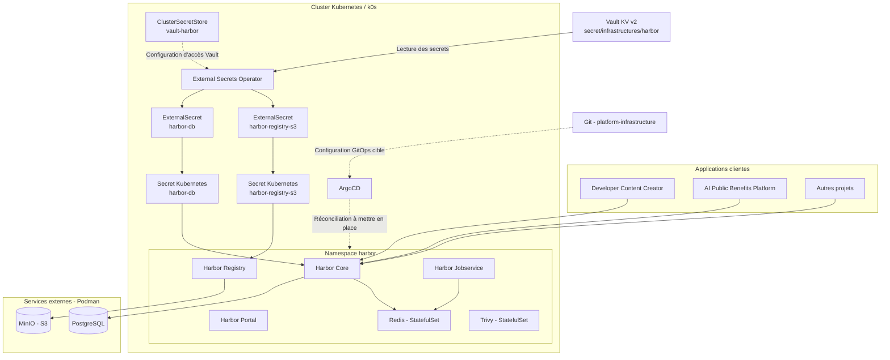

# Harbor — Architecture technique

- **Projet :** Platform Infrastructure
- **Date :** 5 novembre 2026
- **Statut :** Architecture documentée — haute disponibilité et PRA complet à valider
- **Environnement de référence :** Kubernetes / k0s local
- **Namespace :** `harbor`
- **Chart Helm :** `harbor-1.19.4`
- **Version Harbor :** `2.15.4`
- **Révision Helm actuelle :** `3`

---

## 1. Objet et périmètre

### 1.1 Objet

Ce document décrit l'architecture technique de Harbor, utilisé comme registre centralisé d'images Docker et OCI pour les différents projets de la plateforme.

Harbor est un service mutualisé de `platform-infrastructure`. Il est administré indépendamment du cycle de vie des applications clientes.

Ses responsabilités sont les suivantes :

- héberger les images Docker et OCI ;
- gérer les projets, repositories et permissions ;
- fournir les interfaces de publication et de récupération des images ;
- assurer la persistance des blobs dans un stockage objet ;
- centraliser les contrôles d'accès aux images ;
- permettre l'intégration avec les pipelines CI/CD ;
- assurer la traçabilité des opérations.

### 1.2 Périmètre

L'architecture couvre :

- Harbor Core ;
- Harbor Registry ;
- Harbor Portal ;
- Harbor Jobservice ;
- Harbor Trivy ;
- PostgreSQL ;
- Redis ;
- MinIO ;
- Vault et External Secrets Operator ;
- Kubernetes, Helm et ArgoCD ;
- les mécanismes de sauvegarde, restauration et supervision.

Les applications clientes, notamment `developer-content-creator` et `ai-public-benefits-platform`, sont considérées comme des consommatrices du service.

---

## 2. Vue d'ensemble de l'architecture

### 2.1 Architecture logique

L'architecture repose sur une séparation entre les composants applicatifs Harbor et les services de données.

Les composants Harbor, Redis et Trivy sont déployés dans Kubernetes. PostgreSQL et MinIO sont hébergés hors du cluster, dans l'infrastructure Podman.



**Remarque :** le diagramme présente les relations logiques et non l'ensemble des flux internes entre les composants Harbor.

L'intégration Vault / External Secrets Operator dédiée à Harbor est opérationnelle. Le `ClusterSecretStore` `vault-harbor` permet à ESO de lire les secrets dans Vault KV v2 et de synchroniser les ressources Kubernetes correspondantes.

L'intégration GitOps de Harbor avec ArgoCD reste à finaliser et à valider. Les relations Git / ArgoCD / Harbor représentées en pointillés correspondent donc à l'architecture cible et non à un déploiement GitOps déjà opérationnel.

### 2.2 Frontières de déploiement

| Composant | Hébergement | Ressource / fonction |
|---|---|---|
| Harbor Core | Kubernetes | Deployment — API et gestion |
| Harbor Registry | Kubernetes | Deployment — manifests et images |
| Harbor Portal | Kubernetes | Deployment — interface utilisateur |
| Harbor Jobservice | Kubernetes | Deployment — tâches asynchrones |
| Redis | Kubernetes | StatefulSet — cache et files de tâches |
| Trivy | Kubernetes | StatefulSet — analyse des vulnérabilités |
| PostgreSQL | Podman / externe | Base de données des métadonnées |
| MinIO | Podman / externe | Stockage objet des blobs |
| Vault | Service externe | Gestion centralisée des secrets |
| External Secrets Operator | Kubernetes | Synchronisation des secrets |
| ArgoCD | Kubernetes | Réconciliation GitOps de la plateforme |
| Helm | Outil de déploiement | Packaging et configuration Harbor |

Redis et Trivy font partie du périmètre Kubernetes Harbor. Ils ne sont pas des services Podman externes.

PostgreSQL et MinIO sont indépendants du cycle de vie des pods Harbor. Leur disponibilité reste néanmoins une dépendance directe du service.

---

## 3. Architecture de stockage

### 3.1 Stockage objet MinIO

MinIO constitue le backend de stockage objet du Registry.

Le bucket dédié est :

```text
harbor-registry
```

Configuration de référence de l'environnement local :

| Paramètre | Valeur |
|---|---|
| Provider | S3 compatible |
| Service | MinIO |
| Endpoint | `http://192.168.1.40:9000` |
| Bucket | `harbor-registry` |
| Région | `us-east-1` |
| Secret Kubernetes | `harbor-registry-s3` |
| Authentification | Signature AWS V4 |
| Redirection S3 | Désactivée |
| Transport local | HTTP |

Ces paramètres sont propres à l'environnement local. Ils ne doivent pas être considérés comme des valeurs universelles pour les environnements de staging ou de production.

### 3.2 Organisation des blobs

Les blobs des images sont stockés dans MinIO.

Structure logique du stockage Registry :

```text
harbor-registry/
└── docker/
    └── registry/
        └── v2/
            ├── blobs/
            └── repositories/
```

Le stockage objet dissocie la persistance des images du système de fichiers des pods Registry.

La configuration S3 actuellement déployée repose notamment sur :

```yaml
persistence:
  enabled: false
  imageChartStorage:
    type: s3
    disableredirect: true
    s3:
      bucket: harbor-registry
      region: us-east-1
      regionendpoint: http://192.168.1.40:9000
      secure: false
      v4auth: true
      existingSecret: harbor-registry-s3
```

Le fichier de référence est :

```text
infra/kubernetes/harbor/values/values-production.yaml
```

Il contient les paramètres non sensibles et les références aux Secrets Kubernetes, sans credentials en clair.

### 3.3 Isolation du stockage

Le bucket `harbor-registry` est réservé aux images Harbor.

Les autres buckets MinIO, notamment :

- `documents` ;
- `documents-ai` ;
- `applications` ;

ne doivent pas être modifiés par les opérations d'administration Harbor.

Le compte technique utilisé par Harbor doit disposer uniquement des permissions nécessaires sur son bucket.

Les opérations de sauvegarde, restauration et migration doivent respecter cette séparation.

---

## 4. Architecture des métadonnées et des services associés

### 4.1 PostgreSQL

PostgreSQL assure la persistance des métadonnées Harbor.

Configuration connue :

| Paramètre | Valeur |
|---|---|
| Type | PostgreSQL externe |
| Hébergement | Podman |
| Hôte | `192.168.1.40` |
| Port | `5432` |
| Base de données | `harbor` |
| Secret Kubernetes | `harbor-db` |

La base PostgreSQL doit faire l'objet de sauvegardes régulières.

Sa restauration doit être coordonnée avec celle du stockage objet MinIO afin de préserver la cohérence entre les métadonnées et les blobs.

### 4.2 Redis

Redis est déployé dans Kubernetes sous forme de StatefulSet :

```text
harbor-redis
```

Il est utilisé par Harbor pour le cache et les données temporaires, notamment les mécanismes associés aux tâches.

Redis fait partie du périmètre opérationnel Kubernetes Harbor.

Lors de la migration vers MinIO, des entrées de cache incohérentes ont été observées. Une suppression ciblée des clés concernées a permis de rétablir le fonctionnement.

**Interdiction opérationnelle :** ne jamais utiliser `FLUSHDB` ou `FLUSHALL` comme procédure de diagnostic ou de correction standard.

Toute opération de nettoyage Redis doit être précédée d'une analyse et limitée aux clés identifiées.

Le cache Redis est reconstructible dans les conditions normales de fonctionnement, mais sa perte peut provoquer des perturbations temporaires.

### 4.3 Trivy

Trivy est activé dans la configuration Harbor et déployé dans Kubernetes sous forme de StatefulSet :

```text
harbor-trivy
```

Il assure l'analyse des vulnérabilités des images.

Son état doit être contrôlé lors des opérations de maintenance et de restauration.

La base de vulnérabilités de Trivy peut nécessiter une actualisation après une reprise. Elle ne doit pas être confondue avec les données persistantes du Registry.

---

## 5. Architecture de sécurité

### 5.1 Gestion des secrets

Vault constitue la source centralisée des secrets d'infrastructure.

External Secrets Operator est utilisé sur la plateforme pour synchroniser les secrets vers Kubernetes.

Le flux est le suivant :

```text
Vault KV v2
    |
    v
ClusterSecretStore (vault-harbor)
    |
    v
External Secrets Operator
    |
    +--> ExternalSecret harbor-db
    |       |
    |       v
    |    Secret harbor-db
    |
    +--> ExternalSecret harbor-registry-s3
            |
            v
         Secret harbor-registry-s3
```

Les références actuellement utilisées par Harbor sont :

| Secret Kubernetes | Utilisation |
|---|---|
| `harbor-db` | Connexion PostgreSQL |
| `harbor-registry-s3` | Authentification S3 / MinIO |

**État de l'intégration :** l'intégration Vault / External Secrets Operator propre à Harbor est opérationnelle.

Les ressources dédiées sont :

- `ClusterSecretStore` : `vault-harbor` ;
- rôle Vault : `harbor-role` ;
- ServiceAccount : `harbor-vault-auth`, dans le namespace `external-secrets` ;
- ExternalSecret PostgreSQL : `harbor-db` ;
- ExternalSecret stockage S3 : `harbor-registry-s3`.

Les credentials S3 sont stockés dans Vault KV v2, sous le chemin logique `infrastructures/harbor/registry-s3`. ESO les synchronise vers le Secret Kubernetes `harbor-registry-s3`, consommé par Harbor Registry.

Le mot de passe PostgreSQL est géré séparément dans Vault et synchronisé vers le Secret `harbor-db`.

La synchronisation après la rotation manuelle du 5 novembre 2026 a été vérifiée.

Les règles suivantes s'appliquent :

- aucun identifiant ne doit être versionné dans Git ;
- aucun secret ne doit être affiché dans les journaux ;
- les permissions MinIO doivent être limitées au bucket Harbor ;
- les identifiants doivent pouvoir être renouvelés ;
- les secrets doivent être synchronisés selon le mécanisme retenu pour l'environnement.

#### Rotation des credentials S3

La première rotation manuelle a suivi les étapes suivantes :

1. Création d'un nouveau service account MinIO, sans révoquer immédiatement l'ancien.
2. Enregistrement des nouveaux credentials dans Vault KV v2.
3. Synchronisation du Secret Kubernetes par ESO.
4. Vérification de la synchronisation et des références aux credentials.
5. Redémarrage contrôlé de Harbor Registry.
6. Vérification fonctionnelle de l'authentification, du push et de la récupération de l'image avec le nouveau compte.
7. Révocation de l'ancien service account après validation.
8. Réalisation d'un pull à froid depuis un client Docker indépendant, sans image préalablement présente dans son cache local.
9. Comparaison du digest obtenu avec celui de l'image initiale.

La rotation manuelle et les tests fonctionnels sont validés. Le pull à froid indépendant réalisé après révocation confirme la lecture effective des blobs depuis MinIO avec le nouveau compte.

La procédure détaillée et les résultats sont disponibles dans `credential-rotation.md`.

### 5.2 Sécurité réseau

Les communications entre Harbor et les services externes doivent être limitées aux flux nécessaires.

| Source | Destination | Usage |
|---|---|---|
| Harbor Core | PostgreSQL | Accès aux métadonnées |
| Harbor Core / Jobservice | Redis | Cache et tâches |
| Harbor Registry | MinIO | Stockage des blobs |
| Harbor Trivy | Services nécessaires à son fonctionnement | Analyse et actualisation des vulnérabilités |
| External Secrets Operator | Vault | Récupération des secrets |
| Applications clientes | Harbor | Push et pull des images |

Les règles réseau doivent être documentées et appliquées selon le principe du moindre privilège.

### 5.3 TLS

L'environnement local utilise actuellement :

- un endpoint HTTP pour Harbor ;
- un endpoint HTTP pour MinIO ;
- une configuration TLS désactivée dans les valeurs Helm Harbor.

Cette configuration est réservée à l'environnement local.

Pour les environnements exposés :

- activer HTTPS ;
- utiliser des certificats reconnus ;
- protéger les communications interservices ;
- éviter la désactivation de la validation TLS dans les clients ;
- gérer le renouvellement des certificats.

---

## 6. Architecture de déploiement

### 6.1 Kubernetes

Harbor est déployé dans le namespace :

```text
harbor
```

Les composants applicatifs sont principalement des Deployments :

```text
harbor-core
harbor-registry
harbor-portal
harbor-jobservice
```

Redis et Trivy sont des StatefulSets :

```text
harbor-redis
harbor-trivy
```

Commandes de contrôle :

```bash
kubectl -n harbor get deployments
kubectl -n harbor get statefulsets
kubectl -n harbor get pods
kubectl -n harbor get services
```

Les opérations d'exploitation doivent prendre en compte les dépendances externes avant tout redémarrage ou déploiement.

### 6.2 Helm

Harbor est installé à partir du chart Helm officiel.

Versions de référence :

| Composant | Version |
|---|---|
| Harbor | `2.15.4` |
| Helm Chart | `1.19.4` |
| Révision Helm actuelle | `3` |

La configuration de référence est conservée dans :

```text
infra/kubernetes/harbor/values/values-production.yaml
```

Toute modification doit être contrôlée avec la version du chart utilisée.

La configuration doit rester séparée des credentials.

### 6.3 GitOps avec ArgoCD

ArgoCD est utilisé pour piloter la réconciliation GitOps de la plateforme.

Le modèle cible pour Harbor est :

```text
Git
 |
 v
ArgoCD
 |
 v
Helm
 |
 v
Kubernetes
 |
 v
Harbor
```

**État actuel :** l'intégration de la configuration Harbor dans le workflow GitOps reste à finaliser.

Les changements de configuration doivent être préparés dans Git et intégrés au workflow de déploiement après validation.

Il ne faut pas considérer Harbor comme entièrement géré par ArgoCD tant que cette intégration n'a pas été mise en place et testée.

---

## 7. Stratégie multi-projets

Harbor est partagé entre plusieurs projets applicatifs.

Exemples de consommateurs :

| Projet | Usage |
|---|---|
| `developer-content-creator` | Images des services DCC |
| `ai-public-benefits-platform` | Images des microservices métier |
| Autres projets | Images de leurs applications |

Chaque projet doit disposer d'un projet Harbor dédié.

Exemple d'organisation logique :

```text
harbor/
├── developer-content-creator/
│   ├── repository-service
│   ├── ai-orchestrator
│   └── content-service
│
├── ai-public-benefits-platform/
│   ├── document-service
│   ├── eligibility-service
│   └── notification-service
│
└── shared/
    └── images communes
```

Les règles suivantes doivent être appliquées :

- séparation des repositories par projet ;
- permissions adaptées aux équipes ;
- comptes techniques distincts lorsque nécessaire ;
- limitation des droits de push et pull ;
- politiques de rétention adaptées ;
- traçabilité des opérations.

Les permissions Harbor constituent le mécanisme principal d'isolation logique entre projets.

---

## 8. Haute disponibilité et résilience

### 8.1 Principes

La séparation des composants applicatifs et des services de données améliore l'indépendance des cycles de vie.

Elle ne garantit cependant pas automatiquement une haute disponibilité.

L'environnement actuel utilise notamment des composants avec une seule réplique. La haute disponibilité n'est donc pas démontrée.

| Composant | Risque | Mesure attendue |
|---|---|---|
| Kubernetes | Indisponibilité du cluster | Procédure de reprise du cluster |
| Harbor Registry | Indisponibilité du pod | Redémarrage et contrôle de santé |
| PostgreSQL | Perte des métadonnées | Sauvegardes et restauration testée |
| Redis | Perte du cache | Diagnostic et reconstruction contrôlée |
| Trivy | Indisponibilité de l'analyse | Redémarrage et actualisation de la base |
| MinIO | Perte ou indisponibilité des blobs | Sauvegarde et restauration des objets |
| Vault | Indisponibilité des secrets | Procédure de reprise et accès contrôlé |

### 8.2 Stratégie de reprise

La reprise complète de Harbor nécessite de préserver la cohérence entre :

1. les métadonnées PostgreSQL ;
2. les blobs stockés dans MinIO ;
3. la configuration Harbor ;
4. les secrets nécessaires au fonctionnement.

Les sauvegardes PostgreSQL et MinIO réalisées le 4 novembre 2026 ont été restaurées et vérifiées indépendamment.

Cependant, elles n'ont pas été réalisées exactement au même instant. Leur restauration isolée ne constitue donc pas une preuve de cohérence d'un point de récupération coordonné.

**Statut du PRA :**

- sauvegarde PostgreSQL : réalisée ;
- sauvegarde MinIO : réalisée ;
- restauration PostgreSQL isolée : testée ;
- restauration MinIO isolée : testée ;
- vérification cryptographique de blobs : réalisée ;
- restauration coordonnée complète Harbor : à tester.

Les procédures détaillées sont définies dans :

- `backup.md` ;
- `restore.md` ;
- `rollback.md`.

---

## 9. Observabilité

La supervision de Harbor doit couvrir les composants applicatifs et leurs dépendances.

Indicateurs à surveiller :

| Domaine | Indicateurs |
|---|---|
| Harbor Core | Disponibilité des API, erreurs HTTP |
| Registry | Succès et échecs des push/pull |
| PostgreSQL | Disponibilité, connexions, espace disque |
| Redis | Disponibilité, mémoire, erreurs |
| Trivy | État du service et actualisation de la base |
| MinIO | Disponibilité, capacité, erreurs S3 |
| Kubernetes | État des pods, redémarrages, ressources |
| Stockage | Capacité disponible et évolution |

La plateforme d'observabilité cible repose sur :

- Prometheus pour les métriques ;
- Grafana pour les tableaux de bord ;
- Loki pour les journaux ;
- Jaeger pour la traçabilité distribuée lorsque les traces sont disponibles.

Les alertes doivent notamment couvrir :

- l'indisponibilité du Registry ;
- les erreurs d'accès à MinIO ;
- l'indisponibilité de PostgreSQL ;
- les problèmes de connexion Redis ;
- les erreurs d'analyse Trivy ;
- le manque d'espace de stockage ;
- les échecs répétés de push et pull.

La supervision complète et les alertes spécifiques à Harbor restent à formaliser.

---

## 10. Décisions d'architecture

| ID | Décision | Justification |
|---|---|---|
| ADR-HARBOR-001 | Harbor est un service mutualisé | Éviter de déployer un registre par application |
| ADR-HARBOR-002 | PostgreSQL est externe au cluster | Découpler la persistance des métadonnées |
| ADR-HARBOR-003 | Redis est déployé dans Kubernetes | Conserver son intégration avec les composants Harbor |
| ADR-HARBOR-004 | Trivy est déployé dans Kubernetes | Intégrer l'analyse des vulnérabilités à Harbor |
| ADR-HARBOR-005 | MinIO est externe au cluster | Séparer les blobs du cycle de vie du Registry |
| ADR-HARBOR-006 | Stockage S3 compatible | Utiliser un stockage objet persistant |
| ADR-HARBOR-007 | Vault est la source cible des secrets | Centraliser et contrôler les identifiants |
| ADR-HARBOR-008 | External Secrets Operator synchronise les secrets | Éviter les secrets statiques dans Git |
| ADR-HARBOR-009 | ArgoCD pilote le déploiement cible | Adopter un modèle GitOps |
| ADR-HARBOR-010 | Isolation par projets Harbor | Séparer les droits entre applications |

---

## 11. Documentation associée

| Document | Description |
|---|---|
| `README.md` | Index et état opérationnel |
| `minio-migration.md` | Retour d'expérience de migration vers MinIO |
| `backup.md` | Procédure de sauvegarde |
| `restore.md` | Procédure de restauration |
| `rollback.md` | Procédure de retour arrière |
| `troubleshooting.md` | Diagnostic des incidents |
| `credential-rotation.md` | Procédure de rotation des credentials S3 MinIO |

---

## 12. État de l'architecture

| Domaine | Statut |
|---|---|
| Déploiement Harbor sur k0s | Opérationnel |
| PostgreSQL externe | Opérationnel |
| Redis dans Kubernetes | Opérationnel |
| Trivy dans Kubernetes | Opérationnel |
| MinIO externe | Opérationnel |
| Stockage S3 du Registry | Migration validée |
| Isolation du bucket Harbor | Validée |
| Authentification Harbor | Validée |
| Push d'image après rotation S3 | Validé |
| Récupération de l'image depuis un client indépendant | Validée |
| Pull à froid sans cache local | Validé |
| Vérification du digest après récupération | Identique au digest initial |
| Persistance après redémarrage Registry | Validée |
| Rotation manuelle des credentials S3 | Réalisée le 5 novembre 2026 |
| Révocation de l'ancien compte MinIO | Validée |
| Synchronisation Vault / ESO après rotation | Validée |
| Gestion des secrets par Vault / External Secrets | Opérationnelle pour Harbor |
| Déploiement GitOps Harbor | À finaliser |
| Supervision complète | À formaliser |
| Sauvegarde PostgreSQL | Réalisée |
| Sauvegarde MinIO | Réalisée |
| Restauration PostgreSQL isolée | Testée |
| Restauration MinIO isolée | Testée |
| Restauration coordonnée | À valider |
| Haute disponibilité | Non démontrée |

### Conclusion

Harbor constitue un service partagé de la plateforme d'infrastructure. Les composants applicatifs, Redis et Trivy sont déployés dans Kubernetes, tandis que PostgreSQL et MinIO sont hébergés hors du cluster.

Le stockage objet du Registry repose sur MinIO. L'intégration Vault / External Secrets Operator est opérationnelle et une première rotation manuelle des credentials S3 a été réalisée le 5 novembre 2026. L'ancien compte MinIO a été révoqué après les tests fonctionnels.

La récupération à froid a été validée depuis un client Docker indépendant du serveur Harbor. L'image était absente du cache local du client ; le téléchargement a abouti et le digest obtenu est identique au digest initial. Ce test confirme la lecture effective des blobs depuis le stockage MinIO après rotation des credentials.

Les tests de sauvegarde et de restauration isolés ont été réalisés. Les prochaines étapes majeures sont la validation d'une restauration coordonnée, l'industrialisation de la rotation S3 et la finalisation de l'intégration GitOps Harbor avec ArgoCD.