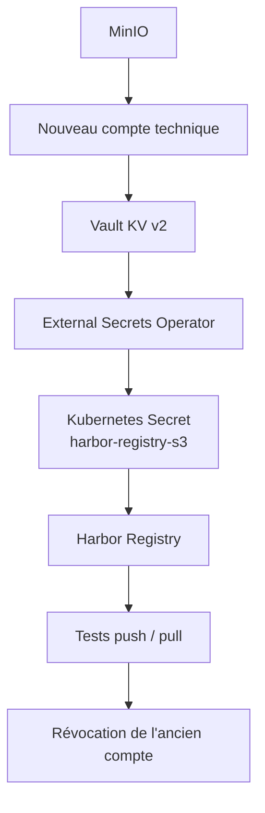

# Harbor — Rotation des credentials MinIO S3

- **Projet :** Platform Infrastructure
- **Date de référence :** 5 novembre 2026
- **Statut :** Rotation manuelle exécutée et validation fonctionnelle réussie le 5 novembre 2026
- **Environnement :** Kubernetes / k0s local
- **Namespace :** `harbor`
- **Bucket MinIO :** `harbor-registry`

---

## 1. Objectif

Ce document décrit la procédure de rotation des identifiants MinIO utilisés par Harbor Registry pour accéder au stockage objet S3.

La rotation vise à :

- renouveler périodiquement les credentials techniques ;
- limiter la durée d'utilisation d'un identifiant ;
- éviter toute interruption de service pendant le renouvellement ;
- centraliser les credentials dans HashiCorp Vault ;
- synchroniser les secrets dans Kubernetes avec External Secrets Operator ;
- révoquer l'ancien compte uniquement après validation du nouveau.

La procédure s'applique exclusivement au compte technique utilisé par Harbor pour le bucket `harbor-registry`.

Elle ne concerne ni les autres buckets MinIO ni les identifiants PostgreSQL.

## 2. Architecture de gestion des credentials

La chaîne de gestion des secrets repose sur quatre composants.

| Composant | Responsabilité |
|---|---|
| MinIO | Création, activation et révocation des comptes techniques |
| Vault KV v2 | Stockage centralisé des credentials |
| External Secrets Operator | Synchronisation des credentials vers Kubernetes |
| Harbor Registry | Utilisation des credentials pour accéder au stockage S3 |

### 2.1 Références de configuration

| Élément | Valeur |
|---|---|
| Compte parent MinIO | `harbor-registry` |
| Bucket | `harbor-registry` |
| Secret Kubernetes | `harbor-registry-s3` |
| ExternalSecret | `harbor-registry-s3` |
| ClusterSecretStore | `vault-harbor` |
| Chemin logique Vault | `infrastructures/harbor/registry-s3` |
| Mount Vault | `secret` |
| Version KV | `v2` |
| Rôle Vault ESO | `harbor-role` |
| ServiceAccount Vault | `harbor-vault-auth` |
| Namespace du ServiceAccount | `external-secrets` |
| Fréquence de rafraîchissement ESO | `1h` |

### 2.2 Flux de synchronisation



L'ancien compte reste actif pendant toute la phase de transition. Sa révocation intervient uniquement après validation du nouveau compte.

Le schéma représente le flux logique de rotation. Il ne détaille pas les opérations intermédiaires de contrôle et de validation.

## 3. Rotation manuelle réalisée le 5 novembre 2026

### 3.1 État initial

Avant la rotation :

- l'ancien compte MinIO était actif ;
- Harbor Registry utilisait ses credentials ;
- Vault constituait la source de référence ;
- ESO synchronisait le Secret Kubernetes.

Le compte parent MinIO `harbor-registry` n'a pas été modifié.

### 3.2 Création du nouveau compte MinIO

Un nouveau service account a été créé à partir du compte parent `harbor-registry`.

La création a été réalisée avec `mc admin user svcacct add`.

Le nouveau compte hérite de la politique du compte parent.

Cette politique est limitée au bucket `harbor-registry` et autorise les opérations nécessaires au Registry :

- `s3:GetBucketLocation` ;
- `s3:ListBucket` ;
- `s3:ListBucketMultipartUploads` ;
- `s3:AbortMultipartUpload` ;
- `s3:DeleteObject` ;
- `s3:GetObject` ;
- `s3:ListMultipartUploadParts` ;
- `s3:PutObject`.

Les credentials générés ont été conservés temporairement dans un fichier JSON protégé par des permissions restrictives.

Aucune clé n'a été inscrite dans le dépôt Git.

### 3.3 Transfert sécurisé vers Vault

Le fichier temporaire contenant les credentials a été transféré vers l'hôte Vault.

Les permissions des fichiers ont été limitées à leur propriétaire.

Les valeurs `accessKey` et `secretKey` ont été extraites dans deux fichiers temporaires distincts.

Ces fichiers ont été placés dans le répertoire accessible au binaire Vault installé via Snap :

```text
/home/mfofana/snap/vault/2354/config/
```

Les fichiers temporaires ont ensuite été utilisés pour mettre à jour le chemin KV v2 :

```text
secret/infrastructures/harbor/registry-s3
```

Les propriétés enregistrées sont :

- `REGISTRY_STORAGE_S3_ACCESSKEY` ;
- `REGISTRY_STORAGE_S3_SECRETKEY`.

L'opération a été effectuée avec un token Vault temporaire dédié à la rotation, disposant d'un TTL de 24 heures et de permissions limitées à ce chemin.

Le token administrateur Vault n'a pas été utilisé.

### 3.4 Synchronisation External Secrets Operator

La synchronisation a été forcée après la mise à jour de Vault.

Commande utilisée :

```bash
kubectl -n harbor annotate externalsecret harbor-registry-s3 \
  force-sync="$(date +%s)" --overwrite
```

La synchronisation a été contrôlée avec :

```bash
kubectl -n harbor get externalsecret harbor-registry-s3
```

Résultat obtenu :

```text
NAME                 STORETYPE            STORE          REFRESH INTERVAL   STATUS         READY
harbor-registry-s3   ClusterSecretStore   vault-harbor   1h                 SecretSynced   True
```

La correspondance entre les credentials présents dans Vault et ceux du Secret Kubernetes a également été vérifiée par empreintes SHA-256, sans afficher les valeurs.

### 3.5 Redémarrage du Registry

Les variables d'environnement du conteneur Registry ne sont pas automatiquement actualisées lorsqu'un Secret Kubernetes est modifié.

Un redémarrage contrôlé a donc été réalisé :

```bash
kubectl -n harbor rollout restart deployment/harbor-registry

kubectl -n harbor rollout status deployment/harbor-registry
```

Le rollout s'est terminé avec succès.

Les journaux du Registry ont été examinés afin de rechercher notamment :

- `AccessDenied` ;
- `InvalidAccessKeyId` ;
- les erreurs d'authentification S3 ;
- les erreurs d'accès au backend MinIO.

Aucune erreur d'authentification S3 n'a été constatée.

### 3.6 Tests Harbor après mise à jour des credentials

Une image de test Alpine a été utilisée dans le projet `library`.

Le test initial comprenait :

1. l'authentification auprès de Harbor ;
2. le push de l'image de test ;
3. le pull de la référence ;
4. la vérification du fonctionnement après mise à jour des credentials.

Les commandes utilisées sur l'environnement Harbor :

```bash
podman login 192.168.1.40:30002

podman push \
  192.168.1.40:30002/library/rotation-test:2026-11

podman pull --policy=always \
  192.168.1.40:30002/library/rotation-test:2026-11
```

Les opérations ont abouti sans erreur d'authentification.

**Limite identifiée lors de ce premier test :** la couche de l'image était déjà présente dans le stockage local Podman. Le pull confirmait la récupération du manifeste auprès de Harbor, mais ne démontrait pas à lui seul que les blobs avaient été intégralement relus depuis MinIO.

Cette limite a été levée par un test complémentaire réalisé depuis un client Docker indépendant, décrit à la section 3.8.

### 3.7 Révocation de l'ancien compte

Après les premières validations, l'ancien service account MinIO a été révoqué.

La révocation a été réalisée avec la commande suivante, après remplacement du placeholder par l'identifiant réel :

```bash
# Remplacer la valeur ci-dessous avant exécution.
# Ne pas copier le placeholder littéralement.
podman exec minio mc admin user svcacct rm \
  local "ANCIEN_ACCESS_KEY_A_REMPLACER"
```

La liste des comptes techniques du compte parent a ensuite été vérifiée.

Le nouveau compte était le seul compte technique actif identifié pour cette rotation.

Un nouveau push et un nouveau pull ont été effectués après révocation, sans erreur.

### 3.8 Validation du stockage objet depuis un client indépendant

Afin de lever la réserve concernant le cache local Podman, un test complémentaire a été réalisé depuis une machine indépendante de l'hôte Harbor.

Le client disposait de Docker 26.1.3.

#### Préparation

La connectivité au registre a été vérifiée :

```bash
curl -sS -o /dev/null \
  -w 'HTTP %{http_code}\n' \
  http://192.168.1.40:30002/v2/
```

Harbor a répondu avec le code HTTP `401`, confirmant que le registre était accessible et exigeait une authentification.

Le registre HTTP a été déclaré dans la configuration Docker du client indépendant via `insecure-registries`.

Après redémarrage du service Docker, la configuration a été vérifiée avec :

```bash
docker info | grep -A 10 "Insecure Registries"
```

L'authentification avec le compte robot Harbor `robot$harbor-robot-agent` a ensuite réussi :

```bash
docker login 192.168.1.40:30002
```

Résultat :

```text
Login Succeeded
```

#### Vérification de l'absence de cache local

Avant le téléchargement, la présence de l'image a été vérifiée :

```bash
docker image inspect \
  192.168.1.40:30002/library/rotation-test:2026-11
```

Résultat :

```text
Error response from daemon: No such image: 192.168.1.40:30002/library/rotation-test:2026-11
```

L'image était donc absente du client indépendant avant le test.

#### Pull à froid

La récupération a été effectuée avec :

```bash
docker pull --platform linux/amd64 \
  192.168.1.40:30002/library/rotation-test:2026-11
```

Les couches ont été téléchargées avec succès (`Pull complete`).

Le digest obtenu a été comparé au digest du test initial :

```text
24ab38714e948bd49d24d566e97c1c104b63f85c2e642685e72393b37cfb9862
```

Les deux digests étaient identiques.

**Résultat :** le pull à froid depuis un client indépendant a réussi. La récupération des blobs via Harbor et le stockage objet MinIO est ainsi validée, sans dépendance au cache local du serveur Harbor.

### 3.9 Nettoyage

Les fichiers temporaires contenant les credentials ont été supprimés :

- fichier JSON initial ;
- fichier temporaire AccessKey ;
- fichier temporaire SecretKey.

La suppression des fichiers a été vérifiée sur les deux hôtes concernés.

Cette opération confirme leur suppression logique, mais ne constitue pas une garantie d'effacement sécurisé des données sur les supports de stockage.

Aucune valeur de credential n'a été ajoutée au dépôt Git.

## 4. Résultat de la rotation

| Contrôle | Résultat |
|---|---|
| Création du nouveau compte MinIO | Réussi |
| Conservation temporaire de l'ancien compte | Réussi |
| Mise à jour Vault KV v2 | Réussi |
| Synchronisation ESO | Réussi |
| Vérification du Secret Kubernetes | Réussi |
| Redémarrage Registry | Réussi |
| Authentification Harbor | Réussi |
| Push avant révocation | Réussi |
| Pull avant révocation (manifeste, couches déjà présentes en cache) | Réussi |
| Révocation de l'ancien compte | Réussie |
| Push après révocation | Réussi |
| Pull après révocation sur l'hôte Harbor | Réussi |
| Authentification depuis un client indépendant | Réussie |
| Absence de l'image dans le cache du client indépendant | Confirmée |
| Pull à froid depuis le client indépendant après révocation | Réussi |
| Téléchargement des couches depuis le Registry | Réussi |
| Vérification du digest | Identique au test initial |
| Nettoyage des fichiers temporaires | Réussi |

**Conclusion :** la rotation manuelle a été exécutée avec succès. Le nouveau compte est utilisé par Harbor Registry, l'ancien compte a été révoqué et la chaîne Vault → ESO → Kubernetes → Harbor fonctionne correctement.

Les tests d'authentification, de publication et de lecture ont réussi. Le pull à froid depuis un client indépendant, associé à la comparaison des digests, confirme également le bon fonctionnement de la lecture du stockage objet MinIO.

La rotation manuelle est donc fonctionnellement validée dans l'environnement testé.

## 5. Procédure de retour arrière

### 5.1 Avant révocation de l'ancien compte

Tant que l'ancien compte n'est pas révoqué, le retour arrière reste possible.

En cas d'échec après la mise à jour de Vault :

1. rétablir les anciennes valeurs dans le chemin KV v2 ;
2. forcer la synchronisation ESO ;
3. vérifier `SecretSynced=True` ;
4. redémarrer Harbor Registry ;
5. contrôler les journaux et effectuer un push de validation ;
6. conserver le nouveau compte actif jusqu'à identification de la cause.

La procédure détaillée est décrite dans `rollback.md`.

### 5.2 Après révocation de l'ancien compte

Après révocation, l'ancien compte doit être considéré comme indisponible.

La restauration d'une ancienne version Vault ne garantit pas le rétablissement du service, car les credentials associés correspondent à un compte MinIO révoqué.

Le retour arrière nécessite alors :

1. la création d'un nouveau compte technique ;
2. l'enregistrement de ses credentials dans Vault ;
3. la synchronisation par ESO ;
4. le redémarrage du Registry ;
5. la validation des opérations de lecture et d'écriture.

Il ne faut jamais supposer qu'un compte révoqué peut être réactivé.

Il ne faut pas non plus supprimer le compte de remplacement tant que le fonctionnement du compte alternatif n'est pas confirmé.

## 6. Critères d'acceptation d'une rotation future

Une rotation future ne peut être considérée comme réussie que si :

- le nouveau compte est actif ;
- sa politique est limitée au bucket Harbor ;
- Vault contient les nouveaux credentials ;
- ESO confirme la synchronisation ;
- le Secret Kubernetes correspond aux valeurs de Vault ;
- le Registry a redémarré correctement ;
- les journaux ne contiennent aucune erreur S3 ;
- un push réussit ;
- un pull à froid depuis un client indépendant réussit ;
- l'ancien compte est révoqué uniquement après validation des tests ;
- un nouveau push et un nouveau pull à froid réussissent après révocation ;
- les fichiers temporaires ont été supprimés ;
- aucune valeur sensible n'a été écrite dans les journaux ou dans Git.

La révocation de l'ancien compte est conditionnée à la validation des tests d'authentification, de synchronisation, de lecture et d'écriture accessibles dans l'environnement de validation.

La validation complète du stockage objet nécessite également un pull à froid depuis un client indépendant.

## 7. Industrialisation envisagée

L'automatisation sera traitée dans une étape distincte.

Les principes retenus sont :

- CronJob Kubernetes avec `concurrencyPolicy: Forbid` ;
- image d'exécution versionnée et non basée sur `latest` ;
- authentification Vault Kubernetes dédiée ;
- permissions MinIO limitées aux opérations nécessaires ;
- gestion des erreurs et des interruptions ;
- retour arrière contrôlé ;
- journaux sans credentials ;
- alertes en cas d'échec ;
- conservation temporaire de l'ancien compte jusqu'à validation complète.

Une fréquence initiale de 90 jours pourra être étudiée, sous réserve de validation de la procédure automatisée.

**Aucune automatisation ne doit révoquer un ancien compte si les tests d'authentification, de lecture et d'écriture ne sont pas tous concluants.**